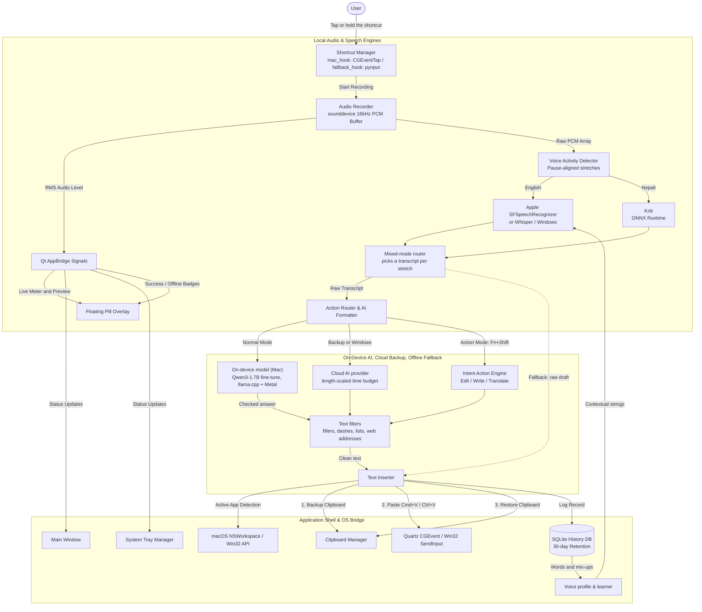

# Just Talk — System Architecture & Technical Specifications (v3.0.1)

> **High-performance, privacy-first, on-device voice keyboard for macOS and Windows.**  
> Think → Speak → Done.

---

## 1. Executive Summary & Design Principles

**Just Talk** is a lightweight desktop productivity utility designed to provide sub-second voice-to-text dictation across any desktop application. Operating unobtrusively in the background via the system menu bar (macOS) or taskbar notification area (Windows), Just Talk captures audio upon a global push-to-talk key press, transcribes it on-device, enhances it via deterministic AI formatting, and inserts the result directly into the active text field.

### Core Architectural Principles:
1. **Audio Stays Local by Default (Privacy-First):** The on-device engines (Apple on-device recognition, Kriti on ONNX Runtime, `faster-whisper`) never send audio anywhere. Google Web Speech is the only engine that does, and Pure Offline Mode turns it off.
2. **Sub-Second Latency:** Streaming 16kHz audio buffer, voice activity detection (VAD), and hardware-accelerated local inference guarantee minimal latency between releasing the key and text insertion.
3. **On-Device AI First (Mac):** Just Talk's own fine-tuned model (Qwen3-1.7B, llama.cpp on Metal) cleans up English and translates Nepali and Nepglish on the device, typically in 0.1 to 0.3 s. Every answer passes sanity checks before it is typed, otherwise the cloud provider (if any) or the raw draft is used.
4. **Deterministic & Resilient AI Formatting:** If enabled, only the plain-text transcript is sent to the user's chosen provider (Gemini, OpenAI, Claude, Grok, Groq, OpenRouter, DeepSeek, any OpenAI-compatible API, or local Ollama) for punctuation, grammar, filler removal and self-correction resolution. The time budget scales with length (~2 s for short phrases, up to ~8 s for long dictation); on timeout or error the locally cleaned transcript is inserted instead.
5. **Non-Intrusive Desktop Integration:** True clipboard preservation restores prior clipboard contents after simulated paste; active window detection ensures text lands where the user expects or falls back safely to the system clipboard.
6. **Modern Native Aesthetics:** Adheres strictly to macOS Big Sur/Sonoma/Sequoia visual standards (frosted glass acrylics, SF Pro / Lato typography, smooth state animations) while fully supporting Windows 10/11 taskbar conventions.

---

## 2. High-Level System Architecture



---

## 3. Subsystem Breakdown

### 3.1 Application Core & Lifecycle (`just_talk/app/`)
* **`main.py`:** Central coordinator. Initializes `QApplication`, configures `freeze_support()` for PyInstaller multiprocessing, sets the Windows `AppUserModelID` (`justtalk.desktop.voiceinput.1.0`) to preserve taskbar pinning, and orchestrates inter-module event signals via `AppBridge`.
* **`single_instance.py`:** Enforces single-process execution using a cross-platform IPC socket / mutex mechanism. Prevents multiple instances from competing for audio devices or global hotkeys.
* **`AppBridge`:** Qt `QObject` signal bridge that decouples background worker threads (audio streaming, neural inference, API calls) from the Qt main GUI thread. Signals include `level_changed`, `state_listening`, `state_processing`, `state_inserted`, and `state_inserted_offline`.

### 3.2 UI & Design System (`just_talk/app/`)
* **Visual language (v2.1):** no emoji in the UI. `icons.py` renders a single set of 1.5 px line icons from inline SVG, tinted with the theme accent. `theme.py` owns all colours; use `ThemeManager.qcolor()` (not `QColor()`) for token colours, because `QColor` cannot parse CSS `rgba()` strings and silently returns black.
* **`wheel_guard.py`:** app-wide event filter — the mouse wheel over a closed dropdown/spin box scrolls the page instead of changing the value (unless the control was tabbed into).
* **Settings** save automatically. Like System Settings, each menu entry is its own page with its title and description at the top. Search shows matches from every page, and clearing it returns to the page you were on.
* **`theme.py`:** Comprehensive macOS-inspired design system:
  * **Typography:** Embedded bundled fonts (`Lato` family, `JetBrains Mono` variable monospace) with fallback to native system fonts (`SF Pro` / `Segoe UI`).
  * **Palette:** Semantic dark/light tokens with translucent surfaces, acrylic borders, smooth hover states, and dynamic status badges.
  * **Custom Controls:** Frosted-glass styled push buttons, custom slider bars, segmented tabs, and rounded combo boxes.
* **`overlay.py` (`FloatingPillOverlay`):** Unobtrusive, borderless floating pill HUD displayed on the user's active screen during speech capture:
  * **Idle:** Hidden or docked.
  * **Listening:** Dynamic multi-bar audio waveform visualizing mic input levels in real time.
  * **Processing:** Smooth pulsing status indicator.
  * **Inserted:** Subtle emerald badge confirmating successful text dispatch.
* **`main_window.py`:** macOS split-view preferences and control center:
  * *Dictation & Status:* Live audio meter, push-to-talk shortcut trigger configuration, mic selector, active Whisper model tier.
  * *History:* Searchable, filterable dictation logs with one-click copy and deletion.
  * *AI Formatting:* Temperature sliders, formatting mode presets (Subtle, Formal, Concise, Code), custom instructions, and offline toggle.
  * *Audio Settings:* VAD sensitivity sliders, input device testing, audio buffer diagnostics.
  * *Diagnostics:* System permissions monitor, RAM footprint, and local model integrity.
* **`onboarding_window.py`:** First-run setup in six screens (`PAGES`: welcome, languages, about, voice, result, ready): permissions, the languages you speak, your kind of work, a voice profile, and a first try. On the voice screen the user reads short sentences, words light up as the engine hears them (`onboarding_widgets.py`), and every speech engine on the computer is scored on that voice in the background. The result names the engine to use, what it mishears, and how close the user is to the 98% goal.
* **`learned_dialog.py`:** "See what it learned" (Settings › Updates & Startup › Learning): every learned word and mix-up, with a way to remove anything wrong so it is never learned again.
* **`tray.py`:** Native system menu bar (macOS) / system tray (Windows) integration providing quick access to Settings, Dictation History, Mute, Force Offline mode, and Exit.

### 3.3 Audio Pipeline (`just_talk/audio/`)
* **`recorder.py`:** Low-latency streaming audio input using `sounddevice` / PortAudio. Captures 16kHz mono 16-bit PCM audio in a ring buffer. Calculates real-time Root-Mean-Square (RMS) amplitude emitted at 60Hz for smooth HUD animation.
* **`vad.py` (`VoiceActivityDetector`):** Detects voice activity and automatically trims leading and trailing dead air. Rejects audio buffers that fall below minimum speech duration or energy thresholds to avoid unnecessary model inference.

### 3.4 Speech-to-Text Subsystem (`just_talk/stt/`)
* **`engine.py`:** Abstract base class establishing the contract for speech-to-text engines (`transcribe(audio: np.ndarray) -> str`).
* **`mac_native_engine.py` (default on macOS):** Apple `SFSpeechRecognizer` (on-device when supported for the locale). Long audio is split at natural pauses (≤15 s chunks via `VoiceActivityDetector.split_on_pauses`) and each chunk's results are merged by `UtteranceTracker`, which keys every result by the audio span it covers. This handles Apple's behaviour of starting a fresh transcript after a pause, revising words, and re-sending finished utterances — without losing or duplicating text. Chunks that error or time out fall back to Google Web Speech (unless Pure Offline Mode).
* **`windows_native_engine.py` (default on Windows):** Google Web Speech first when online, local Whisper otherwise or in Pure Offline Mode.
* **`google_web_engine.py`:** Free Google Web Speech endpoint (sends audio to Google). Long audio is sent as pause-aligned chunks; a network failure mid-dictation returns nothing so callers fall back to an engine that can transcribe everything.
* **`long_form.py` (`IncrementalTranscriber`):** Live-preview helper — earlier speech is transcribed once and cached, only the recent tail is re-decoded, so the HUD always shows the whole dictation.
* **`whisper_engine.py`:** High-efficiency local transcription powered by `faster-whisper` (CTranslate2).
  * Automatically detects and utilizes Apple Silicon Metal / MPS acceleration, NVIDIA CUDA on Windows, or multi-threaded CPU execution.
  * Employs INT8 and FP16 quantization for low memory footprint and sub-second execution on standard consumer laptops.
* **`kriti_engine.py` / `kriti_onnx.py`:** Kriti, the offline Nepali engine, exported to ONNX and run with NumPy + ONNX Runtime only (no NeMo, no PyTorch). Feature extraction, RNNT decoding and danda restoration are reimplemented in NumPy; the export reproduces Kriti's transcripts exactly on the parity clips.
* **Mixed mode (Nepali + English on a Mac), in `app/main.py`:** the recording is cut at pauses into stretches of at most `MIXED_PIECE_SEC` (8 s). Apple and Kriti both transcribe each stretch, and Apple's English is used when Apple was sure (`MIXED_APPLE_MIN_CONFIDENCE` 0.6) and heard the same sounds as Kriti (`MIXED_MIN_SOUND_OVERLAP` 0.55), when Apple was very sure (`MIXED_APPLE_SURE` 0.9), or when Kriti itself wrote English words and no Nepali grammar words (`MIXED_KRITI_ENGLISH_WORDS`, `MIXED_APPLE_MIN_IF_KRITI_ENGLISH`). Finished stretches are recognized, translated and cleaned **while the user is still talking**, in runs of at most `MIXED_TRANSLATE_MAX_WORDS` (40) words, because the on-device model drops sentences from very long Nepali. Only the last run is left when recording stops. If one run's answer is rejected, only that run is typed as heard. The live preview shows each finished stretch as it will be typed.
* **Learned vocabulary:** `mac_native_engine.py` passes up to 100 learned words to Apple as contextual strings, which is what keeps "git" from coming out as "gate".
* **`model_manager.py`:** Multi-tier model catalog and downloader:
  * **Fast / Base (`base.en`):** ~140 MB, ~250ms latency. Optimized for older hardware and fast dictation.
  * **Balanced (`small.en`):** ~460 MB, ~400ms latency. Recommended default with outstanding technical accuracy.
  * **Quality / Multilingual (`large-v3-turbo`):** ~800 MB, ~650ms latency. Supports 99+ languages.

### 3.5 AI Formatting & Intent Routing (`just_talk/ai/`)
* **`providers.py` (`MultiProviderFormatter`):** One formatter for every supported provider (Gemini, OpenAI, Anthropic, Grok, Groq, OpenRouter, DeepSeek, custom OpenAI-compatible endpoints, Ollama):
  * **Time budget:** `_time_budget()` gives short phrases ~2 s and adds time for long dictation (up to ~8 s); with two-phase insertion the raw draft is already typed, so waiting costs nothing visible.
  * **Circuit breaker:** only connection failures and API errors count toward pausing AI formatting (3 in a row → 5 min pause). Slow replies on long text fall back for that dictation only.
  * **Hardened prompt wrapper:** the transcript is framed as data, never instructions, so the model doesn't reply to what was said.
* **`local_model.py` (`LocalModel`), Mac only:** Just Talk's own model ([v6.2](https://huggingface.co/SahasBelbase/justtalk-qwen3-1.7b-gguf), a LoRA fine-tune of Qwen3-1.7B, Q8_0 GGUF, 1.83 GB) on llama.cpp with Metal. Speed comes from four things: the GPU (about 6x faster than CTranslate2's CPU path), a short fixed system prompt so llama.cpp reuses its KV cache across calls, greedy decoding with an output cap tied to the input length plus a light repeat penalty (stops "all all all" loops), and staying loaded while the user is active (it loads while the user speaks; the idle unloader frees it later).
  * **Download:** `download_model()` fetches `MODEL_URL` from Hugging Face, checks `MODEL_SHA256`, and only then replaces the file. An older model already on disk (`OLDER_MODEL_FILES`) keeps working until the new one has arrived.
  * **Automatic setup:** 10 s after launch (once setup is finished), `MainWindow._auto_setup_local_ai()` asks `auto_download_plan()` what to do. The first time it downloads the model in the background and switches it on (`local_ai_auto_done` records that). After that the user's choice stands: newer models are fetched only while it's on, and it is never switched back on once turned off. Skipped in Pure Offline Mode, without the llama.cpp runtime (Windows), and when the disk has less than twice the model's size free.
  * **Tasks:** `translate` (anything with Nepali) and `cleanup` (English), with the exact prompts the model was trained on, plus `edit` and `generate` for Action Mode. The prompts never call "na" or "like" fillers: न means "not" or "please".
  * **Output checks (`check_output`):** an answer is rejected if it is empty, repeats its instructions (unless the speaker said those words), leaves Devanagari untranslated, makes a bullet list nobody asked for (`asks_for_list`), has a length that doesn't match what was said, or repeats a word four times. A rejected answer falls back to the cloud provider or the raw draft.
  * **`keep_leading_answer`:** a leading yes, no or okay that the speaker said is put back if the model dropped it, so a "No" can never disappear.
* **`gemini.py` (`GeminiFormatter`):** Gemini client plus `light_local_cleanup()`, the local fallback used whenever AI formatting is off, slow, or unavailable. It also holds the text filters every AI result goes through:
  * `without_fillers()` removes stretched hesitation sounds (umm, uhh, hmm, उम्म, and उम् as Kriti writes "umm") and touches only lines that contain one, so code indentation stays. Filler and dash cleanup don't run in code contexts at all.
  * `without_ai_dashes()` turns em and en dashes used as punctuation into plain punctuation ("fast — and cheap" → "fast, and cheap"); ranges such as 10–20 and Mon–Fri stay.
  * `is_web_address()`: when the whole dictation is a URL, domain or email, it skips the AI and is typed lowercase without a final period.
* **`prompts.py`:** System instructions per style. The default (Subtle) edits like a careful human editor: resolves self-corrections ("five, actually four" → "four"), removes fillers and false starts, fixes grammar — and never summarizes or drops details. Formal, Concise, Auto, Nepglish and Devanagari variants build on the same core rules.
* **`actions.py` (`ActionRouter`):** Action Mode handler triggered via `Fn + Shift`:
  * Detects spoken action prefixes (e.g., *"translate to French: ..."*, *"summarize this: ..."*, *"reply professionally: ..."*).
  * Routes prompt to Gemini with specialized transformation parameters before typing.

### 3.6 System Integration & Text Insertion (`just_talk/system/`)
* **`inserter.py` (`TextInserter`):**
  1. Inspects the frontmost application using macOS `NSWorkspace` / `CGWindowList` or Windows `GetForegroundWindow`.
  2. Backs up current clipboard data (text, HTML, images).
  3. Writes formatted text to the clipboard.
  4. Dispatches native simulated paste keyboard events:
     * **macOS:** Quartz `CGEventCreateKeyboardEvent` (`Cmd + V`).
     * **Windows:** Win32 `SendInput` (`Ctrl + V`).
  5. Waits 50ms for the target application to ingest the event, then asynchronously restores the user's previous clipboard contents.
  * **macOS paste path:** when the target is in front, Cmd+V is posted the way a real key press travels (HID), because events posted straight to a process were sometimes dropped by Chromium apps. In Chromium browsers only, the focused text box is checked 0.6 s later and the paste is sent once more if it didn't land. Never after replacing a draft or with text selected, and never in terminals, whose input box always reads empty.
  * **Quick draft:** the raw draft is typed first and taken back with Cmd/Ctrl+Z before the polished text goes in. Terminals (including the terminal inside VS Code-style editors) can't undo a paste, so they get no draft.
  6. If no text-accepting application is frontmost, leaves the transcribed text on the clipboard and emits a gentle desktop notification.
* **`clipboard.py`:** Manages safe multi-format clipboard preservation and atomic restoration.
* **`permissions.py`:** Verifies and prompts for OS permissions:
  * macOS Accessibility API permissions (`AXIsProcessTrustedWithOptions`).
  * macOS Microphone access permissions (`AVCaptureDevice`).

### 3.7 Hardware Hotkeys & Key Event Interception (`just_talk/shortcuts/`)
* **`mac_hook.py`:** Native macOS event tap using CoreGraphics `CGEventTapCreate`:
  * Intercepts hardware `Fn` / Globe key events (`kCGEventFlagsSecondaryFn` / `NX_DEVICELCTLKEY`).
  * Solves the notorious macOS limitation where `Fn` cannot normally be bound as a global hold-to-talk key by generic user-space key loggers.
  * Operates without triggering system dictation or interfering with function key media controls.
* **`fallback_hook.py`:** Cross-platform fallback based on `pynput`:
  * Handles Windows global hotkeys (defaulting to **Right Alt**).
  * Allows customizable key combinations (e.g., `Ctrl + Space`, `Cmd + Shift + J`).
* **`mac_escape.py`:** Escape cancels a dictation on macOS. Listening to other apps' key presses needs Input Monitoring, which macOS drops whenever a new ad-hoc signed build is installed, so Escape is a Carbon hot key (no permission needed) registered only while recording and released as soon as it ends. After a cancel, Just Talk yields focus back to the app the user was dictating into.
* **`manager.py` (`ShortcutManager`):** State coordinator managing push-to-talk vs. toggle modes, debouncing rapid key taps, and handling modifier flags.

### 3.8 Security & Persistence (`just_talk/security.py`, `just_talk/database/`)
* **`security.py` (`CredentialManager`):** Stores provider API keys and the custom base URL in a private `.credentials` JSON file inside the app-data folder (`~/Library/Application Support/JustTalk` on macOS, `%APPDATA%\JustTalk` on Windows) with owner-only `0600` permissions. Environment variables (`GEMINI_API_KEY`, etc.) take precedence. Legacy keychain entries are purged silently.
* **`database/history.py` (`HistoryDatabase`):** Local SQLite storage:
  * Logs timestamp, target application, duration, raw transcript, cleaned text, and model tier used.
  * Automatic retention policy trims entries older than 30 days.
  * Completely offline and local; never synchronized to third-party clouds.

### 3.9 Voice Profile & Learning (`just_talk/profile/`)
* **`scripts.py`:** sentences the user reads in voice setup, seeded by their kind of work.
* **`scoring.py`:** aligns a read-aloud take with the sentence shown, word by word, in English or Devanagari.
* **`session.py` / `engines.py`:** one setup session (which sentence comes next, what each engine heard) and the engines being compared, plus switching the app to the one that wins.
* **`learner.py`:** learns each user's own words and the speech engine's mix-ups from voice setup, from every dictation (words shaped like names and jargon, and words AI cleanup swapped for one the user is known to use), from an optional AI review of past dictations (text only), and from the user, who can remove anything learned wrongly.
* **`store.py`:** the saved profile (per-language results, learned mishearings, personal words, clips) in the user's own app-data folder, so app updates never reset it.

---

## 4. Concurrency & Threading Model

```text
┌────────────────────────────────────────────────────────────────────────┐
│                        MAIN GUI THREAD (Qt Event Loop)                 │
│  - QApplication, MainWindow, Overlay, System Tray, Onboarding          │
│  - Receives Qt signals from AppBridge (thread-safe UI redraws)         │
└──────────────────┬─────────────────────────────────▲───────────────────┘
                   │ Starts / Stops                  │ Qt Signals
                   ▼                                 │
┌─────────────────────────────────────────┐ ┌────────┴───────────────────┐
│     BACKGROUND WORKER THREAD POOL       │ │     AUDIO STREAMING THREAD         │
│  - Faster-Whisper CTranslate2 STT       │ │  - sounddevice PortAudio Callback  │
│  - Gemini REST API HTTP calls           │ │  - Rolling 16kHz PCM ring buffer   │
│  - Native simulated paste events        │ │  - Computes RMS level at 60Hz      │
└─────────────────────────────────────────┘ └────────────────────────────┘
                   │
                   ▼
┌─────────────────────────────────────────┐
│       GLOBAL OS HOOK THREAD             │
│  - macOS: CoreGraphics CGEventTap       │
│  - Windows: pynput LowLevelHook         │
│  - Low latency, non-blocking key states │
└─────────────────────────────────────────┘
```

1. **GUI Responsiveness:** The main thread is strictly reserved for UI rendering and system events. No audio I/O, model loading, file writes, or HTTP calls occur on the GUI thread.
   * **Worker → UI callbacks** must go through `ui_thread.run_on_ui_thread(fn)` (a queued Qt signal on a GUI-thread `QObject`). `QTimer.singleShot(0, fn)` from a plain `threading.Thread` silently never fires, because that thread has no Qt event loop.
2. **Audio Stream Continuity:** Audio capture runs in high-priority native PortAudio callbacks, streaming chunks into an in-memory ring buffer.
3. **Async Inference & Timeout:** When the key is released, inference is scheduled on a dedicated background worker. The worker notifies `AppBridge`, which dispatches signals back to the main thread to animate the overlay pill.
4. **Work during recording (Mixed mode):** finished stretches are recognized and translated on worker threads while the user is still talking, so only the last run is left after the key is released. The on-device model is loaded at the start of a dictation, so the first answer doesn't wait for it.

---

## 5. Security & Privacy Guarantees

| Category | Implementation Detail | Guarantee |
| :--- | :--- | :--- |
| **Audio Privacy** | Engine-dependent | Pure Offline Mode / Whisper: audio never leaves the machine. Apple built-in: on-device where supported. Google Web Speech (Nepali; Windows online default): audio is sent to Google. |
| **Credential Storage** | Private `.credentials` file, `0600` permissions | Keys stay on the device and are sent only to the selected provider. |
| **Network Traffic** | HTTPS to the selected AI provider | AI formatting sends text only (never audio). Pure Offline Mode disables all network requests. |
| **On-Device AI** | llama.cpp in the app process (Mac) | Text never leaves the computer. The only network use is the one-time model download, verified with SHA-256. |
| **Clipboard Safety** | Backup -> Paste -> Restore pipeline | The user's clipboard is restored after the paste is consumed. Tests use an in-memory clipboard and never send real keystrokes. |
| **Local Data** | Local SQLite (`history.db` in the app-data folder) | History never leaves the machine. Retention is configurable (default 30 days). |

---

## 6. Build & Packaging Architecture

### 6.1 macOS
* Script: `packaging/mac/build_app.sh`
* Output: `dist/JustTalk.app` and `dist/JustTalk-macOS.dmg`
* Incorporates custom `.icns` multi-resolution icon bundle.
* Configures `Info.plist` with:
  * `NSMicrophoneUsageDescription`: Transparent permission rationale for audio capture.
  * `LSUIElement`: Configures app as an agent/menu bar accessory that doesn't clutter the macOS Dock unless the main window is opened.

### 6.2 Windows
* Zero-Install Launcher: `JustTalk-Launch-Windows.bat` (automatically bootstraps `uv` and launches the application).
* PyInstaller Specification: `packaging/justtalk.spec`.
* Windows Installer: `packaging/windows/installer.iss` (Inno Setup 6 compiler generating `JustTalk-Setup-1.0.0.exe`).
* AppUserModelID binding ensures taskbar pins retain the official multi-tier `.ico` asset.

### 6.3 CI/CD Automation
* **`.github/workflows/build.yml`:** on pushes to `main`, pull requests and `v*` tags — runs the test suite and builds the macOS `.dmg` (macos-14) and Windows Inno Setup `.exe` (windows-latest). On a `v*` tag, a release job publishes both installers plus `SHA256SUMS.txt` to GitHub Releases, which is what the in-app updater reads.
* **`.github/workflows/pages.yml`:** on changes to `website/`, deploys the site to the `gh-pages` branch (GitHub Pages).

---

## 7. On-Device Model: Training & Evaluation

The model is trained outside the app and only its GGUF file ships, downloaded on first use from [Hugging Face](https://huggingface.co/SahasBelbase/justtalk-qwen3-1.7b-gguf).

* **Base and method:** LoRA fine-tune of Qwen3-1.7B with MLX on a MacBook's own GPU (no cloud GPUs). All layers adapted, 8.7 million trainable parameters, one pass, batch size 8, learning rate 1e-4. Merged, converted to GGUF and quantized to Q8_0 (shipped) and Q4_K_M.
* **Data (13,742 examples, 150 kept for validation):** 6,300 Nepali to English pairs from AI4Bharat BPCC (some spoken by a macOS voice and transcribed by Kriti, so the model sees real speech-engine mistakes); 2,619 English sentences spoken with a Nepali accent and written in Devanagari by Kriti; 1,597 English clean-ups, including developer words Apple mishears; 991 rows of real voice (434 recordings used twice, 41 lines dictated through the app used three times); 848 hand-written fixes (negatives paired with positives, hedges, lists asked for and not, fillers, Action Mode edits); 696 everyday Nepglish rows; 691 long run-on dictations. Every English target keeps the meaning, adds and drops nothing, never flips a "not", and has no em dashes or semicolons. The build fails if any held-out test sentence appears in the training data.
* **Evaluation:** chrF++ on frozen sets that are never trained on: real Nepali dictations (29), FLORES+ devtest (200), English clean-up (29), a held-out voice set (91) and held-out app dictations (10), plus 49 behaviour checks (negations, hedges, lists asked for and not, fillers).

| Test (sentences) | Untuned Qwen3 1.7B | v2 | **v6.2 (shipped)** |
| :--- | ---: | ---: | ---: |
| Real Nepali dictations (29) | 35.4 | 40.1 | **41.1** |
| FLORES+ Nepali to English (200) | 40.8 | 40.8 | **42.1** |
| English clean-up (29) | 60.8 | 68.9 | **67.5** |
| Recorded voice, held out (91) | | 48.9 | **56.1** |
| App dictations, held out (10) | | 64.5 | **77.5** |

* **Speed (Apple M5, Q8):** median 0.24 s per Nepali dictation (max 1.06 s), 0.45 s on FLORES+ sentences, 0.12 s per English clean-up.
* Nine versions were trained (v1 to v6.2). Each version's data, scores and what it taught are on the model card.
